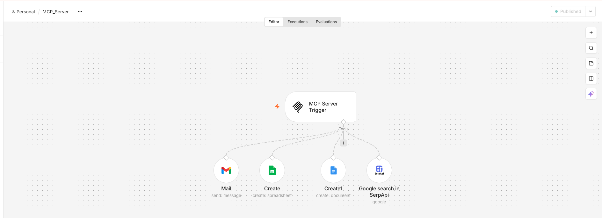
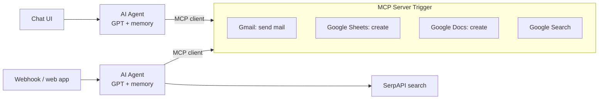

# MCP-Enabled AI Agents (n8n)

An **MCP server** built in n8n that exposes Gmail, Google Sheets, Google Docs and Google Search as tools, and two **AI agents** that discover and use those tools through the Model Context Protocol. Any MCP-compatible client (Claude Desktop, Cursor, another agent) can use the same server.

## How it works

| Workflow | What it does |
| --- | --- |
| `MCP_Server.json` | MCP Server Trigger exposing 4 tools: send Gmail, create a Google Sheet, create a Google Doc, search Google (SerpAPI) |
| `AI_Agent-MCP_Enabled.json` | Chat-triggered agent with conversation memory that calls the MCP server's tools |
| `n8n_Web_app.json` | The same agent behind a webhook, so a web page or app can call it ([screenshot](n8n_webhook.png)) |

Example: *"Search for the top 3 AI news stories today, put them in a new Google Doc and email me the link."* The agent chains search → Docs → Gmail by itself.

## Setup

1. In n8n: **Workflows → Import from File** for each JSON file.
2. Create credentials for OpenAI, Gmail, Google Sheets, Google Docs and SerpAPI, and select them on the nodes.
3. **Secure the endpoints before activating** (see below).
4. In both agent workflows, set the MCP Client endpoint to your server's URL (replace `YOUR-N8N-HOST`).
5. Activate the MCP server workflow, then chat with the agent.

## Security

The MCP server can send email from your account, so never expose it without authentication:

- **MCP Server Trigger → Authentication:** choose *Bearer* or *Header Auth* and set a long random token; give the same token to the MCP client.
- **Webhook → Authentication:** choose *Header Auth* so only your app can call it.
- Keep credentials in n8n's credential store; the exported JSON only references them by name.

## Tech stack

n8n · Model Context Protocol (MCP) · OpenAI · Gmail, Google Sheets & Docs APIs · SerpAPI
